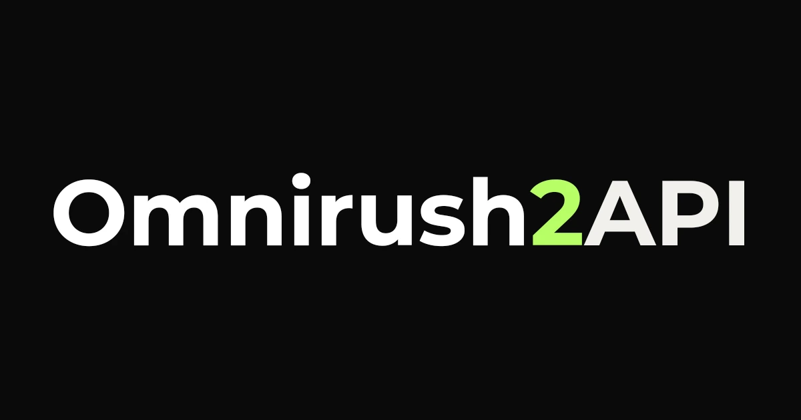

<div align="center">



# Omnirush2API

[](https://www.gnu.org/licenses/gpl-3.0)
[](https://www.npmjs.com/package/omnirush2api)
[](https://github.com/IMROVOID/Omnirush2API/actions/workflows/test.yml)
[](https://nodejs.org/)
[](https://www.typescriptlang.org/)
[](https://workers.cloudflare.com/)
[](https://omnirush.ai)
[](https://platform.openai.com/docs/api-reference)

<p align="center">
  OAuth to OpenAI-compatible API router for Omnirush.ai. Bridge OAuth credentials into a universal API gateway to unlock <b>GPT-6 Astra, GPT-6.1 Sol, and GPT-6 Sol</b> models across <b>Claude Code, Cursor, Codex, OpenCode, Antigravity, Aider, and more</b>.
</p>

[Overview](#what-is-omnirush2api) • [Features](#key-features) • [Quick Start](#quick-start) • [Models](#model-catalog--aliases) • [Clients](#client-integration) • [Architecture](#architecture--structure) • [Guides](#advanced-guides) • [Disclaimer](#disclaimer--legal-notice) • [License](#license)

</div>

## Table of Contents

- [What is Omnirush2API?](#what-is-omnirush2api)
- [Key Features](#key-features)
- [How to Get Your Refresh Token](#how-to-get-your-refresh-token)
  - [1. Automated Script (1-Click Browser Login)](#1-automated-script-recommended---1-click-login)
  - [2. For Method 1: Local Daemon](#2-for-method-1-local-daemon)
  - [3. For Method 2: Cloudflare Workers](#3-for-method-2-cloudflare-workers-serverless)
  - [4. Extracting from OmniRush Desktop App Files](#4-extracting-from-omnirush-desktop-app-files-manual-method)
- [Quick Start](#quick-start)
  - [Method 1: Local Daemon](#method-1-local-daemon)
  - [Method 2: Cloudflare Workers (Serverless)](#method-2-cloudflare-workers-serverless)
- [Model Catalog & Aliases](#model-catalog--aliases)
- [Client Integration](#client-integration)
- [Architecture & Structure](#architecture--structure)
- [Advanced Guides](#advanced-guides)
  - [Multi-Account Pooling & 429 Failover](#multi-account-pooling--429-failover)
  - [Environment Variables](#environment-variables)
- [Development & Testing](#development--testing)
- [Disclaimer & Legal Notice](#disclaimer--legal-notice)
- [License](#license)

## What is Omnirush2API?

[Omnirush.ai](https://omnirush.ai) provides powerful frontier models including **GPT-6 Astra**, **GPT-6.1 Sol**, and **GPT-6 Sol**, delivering deep reasoning, intelligent coding agents, and high-throughput responses through its desktop platform.

However, access to Omnirush quotas is locked behind OAuth device authentication within the official desktop client. Developers could not consume these models as standard OpenAI-compatible endpoints (`sk-...`) in third-party coding agents, test harnesses, or external IDEs.

**Omnirush2API** bridges this gap:

1. It integrates with Omnirush's OAuth Device Flow (`omnirush2api login`) and automatically auto-discovers local credentials from the official desktop app on Windows, macOS, and Linux, proactively rotating access tokens before expiration.
2. It serves a standard OpenAI-compatible gateway (`/v1/chat/completions`, `/v1/responses`, `/v1/models`, `/v1/health`) with Server-Sent Events (SSE) streaming and deep thinking reasoning preservation (`delta.reasoning_content`).
3. It supports both a zero-dependency **Local CLI Daemon** (`localhost:20129`) and a standalone **Cloudflare Worker** (`worker/worker.js`) with multi-account round-robin rotation and automated 429 quota exhaustion fallback.

> **Disclaimer**: This tool is provided strictly for personal educational and interoperability testing purposes. Extracting or reusing OAuth credentials outside official clients carries the risk of account suspension or ban. See [Disclaimer & Legal Notice](#disclaimer--legal-notice).

## Key Features

- **Unlock Omnirush Frontier Models**: Access `gpt-6-astra` (flagship reasoning), `gpt-6.1-sol` (advanced coding), and `gpt-6-sol` (fast iterations).
- **Dual Operational Modes**:
  - **Local Daemon**: Runs on `localhost:20129`, auto-detecting desktop credentials with zero configuration.
  - **Cloudflare Worker**: Standalone 24 KB bundle ready for copy-paste deployment into Cloudflare Workers or Vercel Edge.
- **Interactive Terminal Device Flow (`omnirush2api login`)**: Log into Omnirush directly from the command line without opening or configuring third-party app stores.
- **Desktop Credential Auto-Discovery**: Automatically finds tokens stored in Windows `%APPDATA%\OmniRush\credentials`, macOS Keychain / app support, and Linux configs.
- **Multi-Account Round-Robin**: Pool multiple refresh tokens; requests distribute automatically across accounts.
- **Intelligent 429 Failover**: Automatically detects rate limits and quota caps (`Retry-After`), parks the exhausted account in cooldown, and retries the request transparently with the next ready account.
- **Streaming SSE with Reasoning Delta**: Preserves thinking blocks in `delta.reasoning_content` for real-time rendering in coding assistants.
- **Safe & Resource-Bounded**:
  - Client disconnect cancellation via `AbortSignal` (prevents wasted quotas when cancelling prompts).
  - 120-second upstream timeout guards against stalled connections.
  - 25MB request payload limit protects against buffer exhaustion attacks.
  - Atomic token persistence using secure `0o600` file permissions.

## How to Get Your Refresh Token

Omnirush uses OAuth 2.0 refresh tokens to authorize API requests. You can obtain your refresh token automatically using the built-in login script, or extract it from the OmniRush Desktop app.

### 1. Automated Script (Recommended - 1-Click Login)

The easiest way to get your refresh token is to run the automated login script:

```bash
npm run login
```

Or using the CLI:

```bash
node dist/cli.js login
```

Or directly via npx:

```bash
npx omnirush2api login
```

**What the script does automatically:**
1. Requests an official OAuth Device Authorization session from Omnirush.
2. Automatically launches your default web browser to the verification page with your code pre-filled.
3. Polls the backend securely in the background while you click **"Authorize"** in the browser.
4. Once authorized, **prints your full refresh token in the terminal** so you can easily copy it for Cloudflare Workers.
5. Automatically saves the token to `~/.omnirush2api/tokens.json` for the local daemon.

```text
================================================================================
🎉 Omnirush OAuth Login Successful!
================================================================================

Your Refresh Token (Copy this for Cloudflare Worker secret OMNIRUSH_REFRESH_TOKEN):
--------------------------------------------------------------------------------
omni_ref_a1b2c3d4e5f6...
--------------------------------------------------------------------------------

✓ Account:          developer@example.com (active)
✓ Tokens Remaining: 4,875,000
✓ Saved to Disk:    ~/.omnirush2api/tokens.json
```

---

### 2. For Method 1: Local Daemon

When running the **Local Daemon**, getting and managing the refresh token is **completely automatic**:

- **Option A (Interactive Login)**: Run `npm run login` or `node dist/cli.js login`. The token is automatically persisted to `~/.omnirush2api/tokens.json`. You can start the daemon immediately with `node dist/cli.js start`.
- **Option B (Auto-Discovery from Desktop App)**: If you already have the official [OmniRush Desktop](https://omnirush.ai) app installed and signed in, Omnirush2API **automatically discovers** your existing session from your system with zero setup. Run `node dist/cli.js check` to verify detection.
- **Option C (Environment Variable)**: Export the token directly:
  ```bash
  export OMNIRUSH_REFRESH_TOKEN="omni_ref_your_token_here"
  node dist/cli.js start
  ```

---

### 3. For Method 2: Cloudflare Workers (Serverless)

When deploying to **Cloudflare Workers**, you need your raw refresh token to set as an edge secret:

1. **Obtain the token**:
   Run the login script:
   ```bash
   npm run login
   ```
   Or view all currently stored tokens:
   ```bash
   npm run tokens
   # or: node dist/cli.js tokens list
   ```
2. **Copy the token**:
   Copy the `omni_ref_...` token printed in your terminal.
3. **Add as Worker Secret**:
   In the [Cloudflare Dashboard](https://dash.cloudflare.com):
   - Navigate to **Workers & Pages** -> your `omnirush2api` Worker -> **Settings** -> **Variables and Secrets**.
   - Under **Secrets**, click **Add**.
   - Name: `OMNIRUSH_REFRESH_TOKEN`
   - Value: Paste your copied refresh token.
   - Click **Save and deploy**.

> **Pro Tip (Multi-Account Pooling)**: You can paste multiple refresh tokens (one per line) into `OMNIRUSH_REFRESH_TOKEN`. Omnirush2API will automatically round-robin requests across all accounts and failover on 429 rate limits!

---

### 4. Extracting from OmniRush Desktop App Files (Manual Method)

If you have signed into the OmniRush Desktop app on your computer, your refresh token is stored in the following locations:

- **Windows**:
  - `%APPDATA%\OmniRush\credentials`
  - `%APPDATA%\OmniRush\credentials.fallback` (Plaintext fallback JSON)
- **macOS**:
  - `~/Library/Application Support/OmniRush/credentials`
  - macOS Keychain service: `ai.omnirush.desktop.gateway-refresh`
- **Linux**:
  - `~/.config/OmniRush/credentials`
  - `~/.config/OmniRush/credentials.fallback`

The credentials file contains JSON:
```json
{
  "refresh_token": "omni_ref_...",
  "access_token": "omni_acc_...",
  "gateway_url": "https://omnirush.ai/omnirush/v1",
  "email": "user@example.com"
}
```
You can copy the `"refresh_token"` value directly.

---

## Quick Start

### Method 1: Local Daemon

#### Step 1: Install & Build

Clone and install dependencies:

```bash
git clone https://github.com/IMROVOID/Omnirush2API.git
cd Omnirush2API
npm install
npm run build
```

Or install globally via npm:

```bash
npm install -g omnirush2api
```

#### Step 2: Check or Login Authentication

Authenticate using the interactive terminal OAuth flow:

```bash
node dist/cli.js login
```

Or check if existing local desktop credentials are automatically detected:

```bash
node dist/cli.js check
```

Example output:

```text
[Omnirush2API] Checking local OmniRush credentials and status...

Found 1 unique OmniRush credential(s):

--- [Account #1] ---
  Source: C:\Users\<user>\AppData\Roaming\OmniRush\credentials
  Token:  omni_ref_a1... (128 chars)
  Status: ✓ Active & verified
  Email:  developer@example.com
  Plan:   active
  Tokens Remaining: 4,875,000

Local authentication check complete.
```

#### Step 3: Start the Router

Run with default settings (port `20129`, open access):

```bash
node dist/cli.js start
```

Or specify a custom port:

```bash
node dist/cli.js start --port 20129
```

Or enable optional Bearer API key authorization:

```bash
node dist/cli.js start --port 20129 --key sk-my-secret-key
```

Your local endpoint is available at `http://localhost:20129/v1`.

### Method 2: Cloudflare Workers (Serverless)

Deploy a 24/7 serverless gateway without keeping your computer running.

#### Step 1: Copy the Code

Open [`worker/worker.js`](./worker/worker.js) and copy the entire file contents.

#### Step 2: Create Worker in Cloudflare Dashboard

1. Log into the [Cloudflare Dashboard](https://dash.cloudflare.com).
2. Go to **Workers & Pages** -> **Create application** -> **Create Worker**.
3. Set name to `omnirush2api` and click **Deploy**.
4. Click **Edit code**, select all existing code, delete it, and paste the copied contents of `worker/worker.js`.
5. Click **Deploy** in the top right.

#### Step 3: Add Variables & Secrets

In your Worker, go to **Settings** -> **Variables and Secrets** and add:

| Variable | Type | Required | Description |
|---|---|---|---|
| `OMNIRUSH_REFRESH_TOKEN` | Secret | Yes | Your Omnirush refresh token. Multi-account supported: one token per line. |
| `API_KEY` | Secret | Optional | Client bearer key (e.g. `sk-omnirush-key`). |
| `GATEWAY_URL` | Text | Optional | Upstream URL (defaults to `https://omnirush.ai/omnirush/v1`). |

Click **Save and deploy**.

Your Cloudflare Worker API URL:

```
https://omnirush2api.<your-subdomain>.workers.dev/v1
```

## Model Catalog & Aliases

Omnirush2API automatically maps requested model aliases to canonical upstream models:

| Request Model Alias | Canonical Upstream Model | Context Limit | Max Output | Description |
|---|---|---|---|---|
| `gpt-6-astra`, `astra`, `gpt-6`, `omnirush` | `gpt-6-astra` | 200,000 | 16,384 | Flagship deep reasoning model |
| `gpt-6.1-sol`, `sol-pro` | `gpt-6.1-sol` | 200,000 | 16,384 | Frontier reasoning & coding model |
| `gpt-6-sol`, `sol` | `gpt-6-sol` | 128,000 | 8,192 | Low-latency high-speed model |

## Client Integration

<details>
<summary><b>9Router</b></summary>

Configuration file path:

```text
~/.9router/db.json
```

Or configure via Web Dashboard under **Providers** -> **Add Custom Provider**:

- Provider Type:

```text
openai
```

- Base URL:

```text
http://localhost:20129/v1
```

- API Key:

```text
sk-omnirush
```

- Models:

```text
gpt-6-astra, gpt-6.1-sol, gpt-6-sol
```

Configuration entry for `~/.9router/db.json`:

```json
{
  "providers": [
    {
      "id": "omnirush2api",
      "name": "Omnirush2API",
      "type": "openai",
      "baseUrl": "http://localhost:20129/v1",
      "apiKey": "sk-omnirush",
      "models": [
        "gpt-6-astra",
        "gpt-6.1-sol",
        "gpt-6-sol"
      ]
    }
  ]
}
```

</details>

<details>
<summary><b>Aider</b></summary>

Configuration file path:

```text
.aider.conf.yml
```

Add configuration:

```yaml
openai-api-base: http://localhost:20129/v1
openai-api-key: sk-omnirush
model: openai/gpt-6-astra
```

</details>

<details>
<summary><b>Antigravity (AGY)</b></summary>

Configuration file path:

```text
~/.gemini/antigravity/antigravity.json
```

Add configuration:

```json
{
  "modelProviders": {
    "omnirush2api": {
      "type": "openai",
      "baseUrl": "http://localhost:20129/v1",
      "apiKey": "sk-omnirush",
      "defaultModel": "gpt-6-astra"
    }
  }
}
```

</details>

<details>
<summary><b>Cherry Studio</b></summary>

Configuration file path:

```text
~/.cherry-studio/config.json
```

Or configure via UI in **Settings** -> **Providers** -> **OpenAI**:

- Custom Server Address:

```text
http://localhost:20129/v1
```

- API Key:

```text
sk-omnirush
```

- Models:

```text
gpt-6-astra
```

```text
gpt-6.1-sol
```

```text
gpt-6-sol
```

</details>

<details>
<summary><b>Claude Code</b></summary>

Configuration file path (Global):

```text
~/.claude/settings.json
```

Configuration file path (Project-level):

```text
.claude/settings.json
```

Add configuration:

```json
{
  "env": {
    "OPENAI_BASE_URL": "http://localhost:20129/v1",
    "OPENAI_API_KEY": "sk-omnirush",
    "ANTHROPIC_MODEL": "gpt-6-astra"
  }
}
```

Then run:

```bash
claude
```

</details>

<details>
<summary><b>Cline</b></summary>

Configuration file path:

```text
.vscode/settings.json
```

Add configuration:

```json
{
  "cline.apiProvider": "openai-compatible",
  "cline.openAiBaseUrl": "http://localhost:20129/v1",
  "cline.openAiApiKey": "sk-omnirush",
  "cline.openAiModelId": "gpt-6-astra"
}
```

</details>

<details>
<summary><b>Codex</b></summary>

Configuration file path:

```text
~/.codex/config.toml
```

Add configuration:

```toml
[model]
provider = "openai"
base_url = "http://localhost:20129/v1"
api_key = "sk-omnirush"
model_name = "gpt-6-astra"
```

</details>

<details>
<summary><b>Continue.dev</b></summary>

Configuration file path:

```text
~/.continue/config.json
```

Add configuration:

```json
{
  "models": [
    {
      "title": "GPT-6 Astra",
      "provider": "openai",
      "model": "gpt-6-astra",
      "apiBase": "http://localhost:20129/v1",
      "apiKey": "sk-omnirush"
    }
  ]
}
```

</details>

<details>
<summary><b>Cursor</b></summary>

Configuration file path (Global):

```text
~/.cursor/User/settings.json
```

Configuration file path (Project-level):

```text
.vscode/settings.json
```

Add configuration:

```json
{
  "cursor.openaiBaseUrl": "http://localhost:20129/v1",
  "cursor.openaiApiKey": "sk-omnirush",
  "cursor.model": "gpt-6-astra"
}
```

Or configure in **Cursor Settings** -> **Models**:

- Toggle **Override OpenAI Base URL**: `http://localhost:20129/v1`
- Set **OpenAI API Key**: `sk-omnirush`
- Add model: `gpt-6-astra`

</details>

<details>
<summary><b>DeepSeek Harness</b></summary>

Configuration file path:

```text
agent.yaml
```

Add configuration:

```yaml
llm:
  api_type: openai
  base_url: "http://localhost:20129/v1"
  api_key: "sk-omnirush"
  model: "gpt-6-astra"
  temperature: 0.7
```

</details>

<details>
<summary><b>Hermes</b></summary>

Configuration file path:

```text
~/.hermes/config.json
```

Add configuration:

```json
{
  "llm": {
    "provider": "openai",
    "baseUrl": "http://localhost:20129/v1",
    "apiKey": "sk-omnirush",
    "model": "gpt-6-astra"
  }
}
```

</details>

<details>
<summary><b>LibreChat</b></summary>

Configuration file path:

```text
librechat.yaml
```

Add configuration:

```yaml
endpoints:
  custom:
    - name: "Omnirush2API"
      apiKey: "sk-omnirush"
      baseURL: "http://localhost:20129/v1"
      models:
        default: ["gpt-6-astra", "gpt-6.1-sol", "gpt-6-sol"]
      titleConvo: true
      modelDisplayLabel: "OmniRush"
```

</details>

<details>
<summary><b>NextChat (ChatGPT-Next-Web)</b></summary>

Configuration file path:

```text
.env.local
```

Add configuration:

```env
BASE_URL=http://localhost:20129
OPENAI_API_KEY=sk-omnirush
CUSTOM_MODELS=-all,+gpt-6-astra,+gpt-6.1-sol,+gpt-6-sol
```

</details>

<details>
<summary><b>OmniRoute</b></summary>

Configuration file path:

```text
~/.omniroute/providers.json
```

Add configuration via CLI:

```bash
omniroute provider add --id omnirush2api --type openai --base-url http://localhost:20129/v1 --api-key sk-omnirush --models gpt-6-astra,gpt-6.1-sol,gpt-6-sol
```

Or add configuration to `~/.omniroute/providers.json`:

```json
{
  "providers": [
    {
      "id": "omnirush2api",
      "name": "Omnirush Gateway",
      "type": "openai-compatible",
      "baseUrl": "http://localhost:20129/v1",
      "apiKey": "sk-omnirush",
      "models": [
        "gpt-6-astra",
        "gpt-6.1-sol",
        "gpt-6-sol"
      ]
    }
  ]
}
```

</details>

<details>
<summary><b>OpenAI Compatible (Generic / SDKs)</b></summary>

Configuration file path:

```text
.env
```

Add environment configuration:

```env
OPENAI_BASE_URL="http://localhost:20129/v1"
OPENAI_API_KEY="sk-omnirush"
```

Python SDK example:

```python
from openai import OpenAI

client = OpenAI(
    base_url="http://localhost:20129/v1",
    api_key="sk-omnirush"
)

response = client.chat.completions.create(
    model="gpt-6-astra",
    messages=[{"role": "user", "content": "Write quicksort in Python."}],
    stream=True
)

for chunk in response:
    content = chunk.choices[0].delta.content or ""
    print(content, end="", flush=True)
```

Node.js SDK example:

```javascript
import OpenAI from "openai";

const client = new OpenAI({
  baseURL: "http://localhost:20129/v1",
  apiKey: "sk-omnirush",
});

const response = await client.chat.completions.create({
  model="gpt-6-astra",
  messages: [{ role: "user", content: "Write quicksort in TypeScript." }],
});

console.log(response.choices[0].message.content);
```

cURL command:

```bash
curl -X POST http://localhost:20129/v1/chat/completions \
  -H "Content-Type: application/json" \
  -H "Authorization: Bearer sk-omnirush" \
  -d '{"model":"gpt-6-astra","messages":[{"role":"user","content":"Hello!"}]}'
```

</details>

<details>
<summary><b>OpenClaw</b></summary>

Configuration file path:

```text
openclaw.json
```

Add configuration:

```json
{
  "providers": {
    "omnirush2api": {
      "type": "openai-compatible",
      "baseURL": "http://localhost:20129/v1",
      "apiKey": "sk-omnirush",
      "models": [
        "gpt-6-astra",
        "gpt-6.1-sol",
        "gpt-6-sol"
      ]
    }
  }
}
```

</details>

<details>
<summary><b>OpenCode</b></summary>

Configuration file path (Linux / macOS):

```text
~/.local/share/opencode/opencode.jsonc
```

Configuration file path (Project-level):

```text
opencode.jsonc
```

Add configuration:

```jsonc
{
  "providers": {
    "omnirush2api": {
      "type": "openai-compatible",
      "baseUrl": "http://localhost:20129/v1",
      "apiKey": "sk-omnirush",
      "models": [
        "gpt-6-astra",
        "gpt-6.1-sol",
        "gpt-6-sol"
      ]
    }
  },
  "default_model": "omnirush2api/gpt-6-astra"
}
```

</details>

<details>
<summary><b>OpenHands (OpenDevin)</b></summary>

Configuration file path:

```text
config.toml
```

Add configuration:

```toml
[llm]
model = "openai/gpt-6-astra"
base_url = "http://localhost:20129/v1"
api_key = "sk-omnirush"
```

</details>

<details>
<summary><b>Roo Code</b></summary>

Configuration file path:

```text
.vscode/settings.json
```

Add configuration:

```json
{
  "roo-cline.apiProvider": "openai-compatible",
  "roo-cline.openAiBaseUrl": "http://localhost:20129/v1",
  "roo-cline.openAiApiKey": "sk-omnirush",
  "roo-cline.openAiModelId": "gpt-6-astra"
}
```

</details>

<details>
<summary><b>Trae (ByteDance Agentic IDE)</b></summary>

Configuration file path:

```text
~/.trae/config.json
```

Add configuration:

```json
{
  "modelProviders": [
    {
      "name": "Omnirush2API",
      "apiType": "openai",
      "endpoint": "http://localhost:20129/v1",
      "apiKey": "sk-omnirush",
      "models": [
        "gpt-6-astra",
        "gpt-6.1-sol",
        "gpt-6-sol"
      ]
    }
  ]
}
```

</details>

<details>
<summary><b>Windsurf</b></summary>

Configuration file path:

```text
~/.codeium/windsurf/model_config.json
```

Add configuration:

```json
{
  "customOpenAI": {
    "endpoint": "http://localhost:20129/v1",
    "apiKey": "sk-omnirush",
    "model": "gpt-6-astra"
  }
}
```

</details>

## Architecture & Structure

```
Omnirush2API/
├── src/
│   ├── types/
│   │   ├── auth.ts              # OAuth contracts, pool states, device authorize models
│   │   ├── openai.ts            # OpenAI request/response/SSE schemas & chunk deltas
│   │   └── config.ts            # Server and Cloudflare Worker runtime configuration
│   ├── auth/
│   │   ├── oauth-client.ts      # Device code flow, token exchange & proactive refresh
│   │   ├── clicreds.ts          # OS desktop credential auto-discovery (Windows/macOS/Linux)
│   │   ├── token-store.ts       # Secure ~/.omnirush2api/tokens.json atomic storage
│   │   └── pool-manager.ts      # Multi-account round-robin pool with 429 cooldown backoff
│   ├── proxy/
│   │   ├── model-catalog.ts     # Model list & alias resolver (astra, gpt-6 -> gpt-6-astra)
│   │   ├── normalizer.ts        # Request normalizer for Omnirush wire API
│   │   ├── stream-transformer.ts# Real-time SSE transformer with reasoning_content support
│   │   └── completion-handler.ts# Core completion proxy with cancellation & failover retry
│   ├── server/
│   │   ├── routes.ts            # Route dispatcher (/v1/models, /v1/chat/completions, /v1/health)
│   │   └── http-server.ts       # Native Node.js HTTP server with graceful shutdown
│   ├── cli/
│   │   ├── commands/
│   │   │   ├── login.ts         # Interactive terminal device OAuth login flow
│   │   │   ├── check.ts         # Credentials verification & quota status inspect
│   │   │   ├── start.ts         # Daemon launcher with argument parsing
│   │   │   └── tokens.ts        # Token pool management (list, add, remove)
│   │   └── index.ts             # CLI command dispatcher
│   └── worker/
│       └── index.ts             # Cloudflare Workers / Vercel Edge fetch entrypoint
├── worker/
│   └── worker.js                # Standalone zero-dependency Cloudflare Worker bundle (24 KB)
├── dist/
│   └── cli.js                   # Standalone Node.js CLI executable bundle (46 KB)
├── tests/                       # 36 automated unit & integration tests
├── scripts/
│   └── build.ts                 # esbuild build pipeline
├── package.json
└── tsconfig.json
```

## Advanced Guides

### Multi-Account Pooling & 429 Failover

If an account reaches its quota limit, Omnirush2API automatically shifts traffic to the next account without interrupting your active coding session.

In Cloudflare Workers or your local environment, pass multiple refresh tokens separated by newlines in `OMNIRUSH_REFRESH_TOKEN`:

```env
OMNIRUSH_REFRESH_TOKEN="token_account_1
token_account_2
token_account_3"
```

**Workflow**:

1. **Round-Robin**: Requests cycle across active accounts to distribute load evenly.
2. **Quota Detection**: When an account encounters HTTP 429 (`Retry-After`), the router parses the duration and parks that account in cooldown.
3. **Transparent Retry**: The current request is immediately retried using the next available account in the pool.
4. **Health Diagnostics**: Query `/v1/health` to monitor active versus cooldown accounts.

### Environment Variables

| Variable | Mode | Default | Description |
|---|---|---|---|
| `PORT` | Local | `20129` | Local HTTP daemon port |
| `HOST` | Local | `127.0.0.1` | Local bind address |
| `API_KEY` | Both | *(None)* | Client authorization bearer token |
| `OMNIRUSH_REFRESH_TOKEN` | Both | *(From tokens.json)*| Newline-separated list of refresh tokens |
| `OMNIRUSH_GATEWAY_URL` | Both | `https://omnirush.ai/omnirush/v1` | Upstream Omnirush gateway URL |

## Development & Testing

Run typecheck:

```bash
npm run typecheck
```

Run automated test suite:

```bash
npm test
```

Build standalone bundles:

```bash
npm run build
```

### Continuous Integration (CI)

Every commit and pull request runs automated verification through GitHub Actions:
- **Typecheck**: `npm run typecheck`
- **Unit & Integration Tests**: `npm test`
- **Bundle Verification**: `npm run build`

#### Skipping Automated Tests

To skip the test suite on specific commits (e.g. for docs updates or asset additions), include any of the following tags in the commit message:

- `[skip test]` or `[skip tests]`
- `[skip-test]` or `[skip-tests]`

## Disclaimer & Legal Notice

> **IMPORTANT**: Please read this notice carefully before using or deploying Omnirush2API.

1. **Educational & Research Purposes Only**: This project is developed and distributed exclusively for personal educational, research, and non-commercial API interoperability testing purposes.
2. **Risk of Account Suspension or Ban**: Extracting OAuth tokens, managing session credentials, or routing automated API requests outside the official Omnirush Desktop client may violate Omnirush's Terms of Service and End User License Agreements. Omnirush may rate-limit, revoke tokens for, suspend, or permanently ban your account without prior warning.
3. **No Warranty & No Guarantee**: The author and contributors make no claims, promises, or guarantees regarding the safety, status, or longevity of your Omnirush account. This software is provided "AS IS", without warranty of any kind, express or implied.
4. **Assumption of Risk**: You assume full and sole responsibility for any outcomes or damages resulting from using this software, including but not limited to account termination, loss of API access, or data loss. Use strictly at your own risk.
5. **Trademark Attribution**: All product names, logos, and brands (such as "Omnirush", "GPT-6 Astra", "GPT-6 Sol") are trademarks or registered trademarks of their respective owners. Omnirush2API is an independent open-source project and is neither affiliated with, maintained by, nor endorsed by Omnirush.ai.

## License

This project is licensed under the **GNU General Public License v3.0 (GPLv3)**. See the [LICENSE](./LICENSE) file for details.
